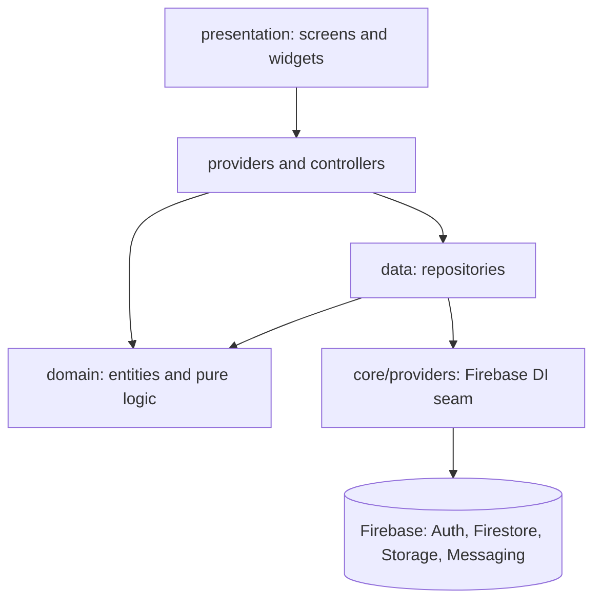
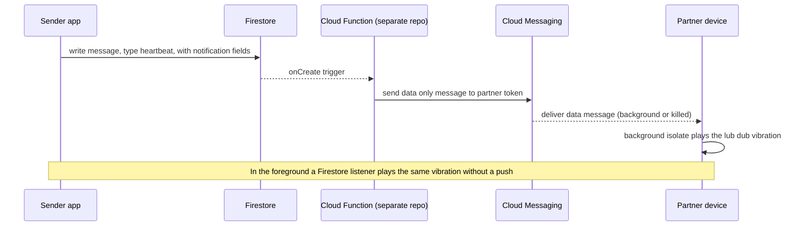

# Symphonia

A private companion app for couples. Two people pair their phones and stay
connected through heartbeats, hugs, messages, voice notes, shared photos,
countdowns, notes, and a live location and "ring my phone" feature.

[](https://github.com/Abhishek-S-777/symphonia/actions/workflows/ci.yml)


Built with AI assistance; architecture, review and refactoring by me.

Android only. There is no iOS build in this repository (no `ios/` directory),
so the platform badge reflects Android alone.

## Contents

- [Screenshots](#screenshots)
- [Features](#features)
- [Architecture](#architecture)
- [The heartbeat flow end to end](#the-heartbeat-flow-end-to-end)
- [Tech stack](#tech-stack)
- [Data model and security](#data-model-and-security)
- [Cloud Functions](#cloud-functions)
- [Getting started](#getting-started)
- [Running the tests](#running-the-tests)
- [Privacy](#privacy)
- [License](#license)

## Screenshots

Screenshots are not committed yet. The screens worth capturing for a gallery:

1. Home (heartbeat button, hugs mode, daily note, days together)
2. Messages with read receipts
3. Voice notes
4. Gallery of shared memories
5. Events and countdowns
6. Notes (rich text)
7. Find partner (map and ring)
8. Pairing screen
9. Settings with biometric lock

## Features

- Heartbeat. One tap sends a heartbeat to the partner. Their phone plays a
  lub dub vibration pattern, in the foreground through a Firestore listener and
  in the background or when the app is killed through a data only push message.
- Hugs and kisses. Hold to build up a duration, release to send. The partner
  feels a matching vibration.
- Messages. Text messages with read receipts and an unread count.
- Daily note. A short note shared between the two partners, synced live.
- Voice notes. Record and send short audio clips, stored in Firebase Storage.
- Gallery. Shared photo memories with captions and dates.
- Events and countdowns. Anniversaries and milestones with one time, weekly,
  monthly, or yearly recurrence, local reminders on the creator device, and
  partner push reminders from the backend.
- Notes. A rich text notepad shared by the couple.
- Find partner. Live location sharing on a map, plus a "ring my phone" feature
  to make the partner device ring.
- Partner pairing. A six digit code valid for a day pairs exactly two devices.
- Biometric lock. Optional fingerprint or face unlock on launch and on resume.

## Architecture

The app follows a feature first layout with a small, explicit layering inside
each feature.

- `presentation` holds screens and widgets.
- `domain` holds plain entities and pure logic (for example days together and
  event recurrence). It has no Firebase imports, which is what makes it directly
  unit testable.
- `data` holds repositories that read and write Firestore and Storage and map
  documents to and from entities.

Every repository and service reaches Firebase through providers defined in
`lib/core/providers/firebase_providers.dart` rather than touching
`FirebaseFirestore.instance` and friends directly. That single seam is what lets
the tests swap in an in memory fake. The only direct SDK access left is in those
provider definitions and in the FCM background isolate, which runs without a
Riverpod container.



Directory layout:

```
lib/
  core/
    constants/    Firestore collection and field names
    errors/       shared error types
    logging/      AppLogger wrapper over dart:developer
    permissions/  runtime permission handling
    providers/    firebase_providers.dart, the Firebase DI seam
    router/       go_router configuration
    services/     platform services (audio, biometrics, fcm,
                  notification, permission, ring, vibration)
    theme/        colors, gradients, typography
  features/<feature>/
    data/         repositories and providers
    domain/       entities and pure logic
    presentation/ screens and widgets
```

Features: `auth`, `home`, `messages`, `voice_notes`, `gallery`, `events`,
`notes`, `find_partner`, `settings`.

## The heartbeat flow end to end

The heartbeat is the signature feature, and it shows how the whole system fits
together. A heartbeat must reach the partner even when their app is closed, so
it travels as a data only push message that a background isolate turns into a
vibration.



Hugs follow the same path with a different vibration pattern. Messages, voice
notes, and events reuse the same Firestore write plus Cloud Function pattern for
their notifications.

## Tech stack

| Category | Technology |
|----------|------------|
| Framework | Flutter 3.38.5 (pinned with FVM) |
| Language | Dart 3.8 |
| State management | Riverpod 3 (stream and async providers) |
| Navigation | go_router |
| Backend | Firebase Auth, Firestore, Storage, Cloud Messaging |
| Notifications | flutter_local_notifications and FCM |
| Biometrics | local_auth |
| Maps and location | google_maps_flutter and geolocator |
| Rich text | flutter_quill |
| Lints | very_good_analysis (strict casts, inference, raw types) |
| Tests | flutter_test and fake_cloud_firestore |

## Data model and security

Firestore is organised around one document per couple with all shared content in
subcollections, so a couple's data is never mixed with anyone else's.

```
users/{userId}
  email, displayName, photoUrl, coupleId, fcmToken, deviceId,
  isOnline, lastActive, createdAt

couples/{coupleId}
  user1Id, user2Id, user1Email, user2Email, pairedAt, anniversaryDate
  messages/{id}     senderId, content, type, sentAt, readAt
  voiceNotes/{id}   senderId, storageUrl, duration, createdAt
  memories/{id}     creatorId, imageUrls, note, date
  events/{id}       creatorId, title, eventDate, isRecurring, recurringType
  notes/{id}        shared rich text
  locations/{id}    userId, latitude, longitude, timestamp

pairingCodes/{code}
  creatorId, createdAt, expiresAt
```

Access rules live in the repository and are tested on the Firebase emulator:

- `firestore.rules` restricts every couple document and subcollection to the two
  paired members. User documents are readable by any signed in user (a partner
  must be able to show a profile) and writable only by the owner, with one
  narrow exception: during pairing a partner may set only the `coupleId` field
  on the other user document.
- `storage.rules` restricts voice notes and memories to couple members and
  limits profile images to the owner, image types only, under a size cap.
- `firestore.indexes.json` holds the composite indexes the queries need.
- `firestore_tests/` contains emulator tests for the rules above.

A known limitation: the pairing handshake needs a cross user write that the
client cannot authorise tightly on its own. The rules keep it as narrow as
possible (only the `coupleId` field), and the proper fix is to move the
handshake into a Cloud Function. This is documented rather than hidden.

## Cloud Functions

The push notifications are sent by Firebase Cloud Functions that react to
Firestore writes. Those functions live in a separate repository and are not
part of this codebase. The client writes the notification fields onto each
document, and the functions read them and forward the push to the partner. The
app runs without them, but partners will not receive push notifications until
they are deployed.

## Getting started

Prerequisites:

- Flutter 3.38.5 (FVM recommended, the version is pinned in `.fvmrc`)
- Android Studio or VS Code
- An Android device or emulator, minimum SDK 24
- Your own Firebase project

```bash
git clone <repository-url>
cd symphonia
fvm flutter pub get
fvm flutter run
```

Point the app at your own Firebase project:

1. Create a project at the Firebase console.
2. Register an Android app with the package name `com.symphonia.app` and add the
   debug SHA-1 key.
3. Download `google-services.json` into `android/app/`.
4. Enable Email and Password authentication, Firestore, Storage, and Cloud
   Messaging.
5. Deploy the rules and indexes:

   ```bash
   firebase deploy --only firestore:rules,firestore:indexes,storage
   ```

6. Deploy the Cloud Functions from their own repository if you want push
   notifications.

## Running the tests

Unit and repository tests:

```bash
fvm flutter test
```

Static analysis under the strict lint set:

```bash
fvm flutter analyze
```

Firestore security rules tests on the emulator:

```bash
cd firestore_tests
npm install
npm test
```

## Privacy

Data is scoped to a single couple and stored in the Firebase project you deploy
to. There are no global feeds and no cross couple access. Sensitive content is
delivered as data only push messages so the device, not a third party, decides
how to present it. The biometric lock is optional and can gate access on launch
and on resume.

## License

Released under the MIT License. See [LICENSE](LICENSE).
